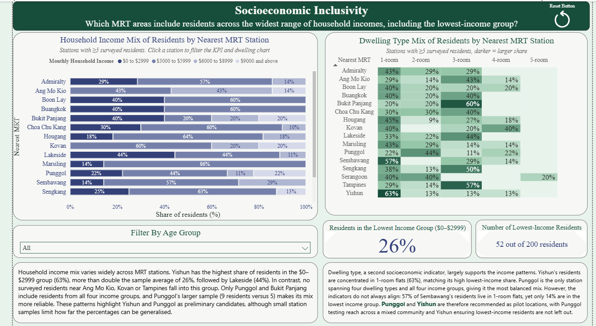

# Socioeconomic Inclusivity Dashboard (Power BI)

**Question:** Which MRT areas in Singapore include residents across the widest range of household incomes, including the lowest-income group?

This was my individual page in a 5-member team project. The team built a Power BI dashboard to recommend where to pilot a new product launch in Singapore, as part of a school assessment project, and each member analysed one sub-topic on their own page. Mine focused on socioeconomic inclusivity, linked to UN SDG 10 (Reduced Inequalities, Target 10.2), so the pilot wouldn't only reach well-off areas.



## Data
Survey of 200 residents: household income, dwelling type, nearest MRT station and age group.

## What I built
- **100% stacked bar:** household income mix by MRT station, across four income bands
- **Matrix heatmap:** dwelling type mix by station, as a second indicator to cross-check income patterns
- **KPI:** 26% of residents (52 of 200) fall in the lowest income group ($0–$2,999)
- **Age group slicer**, with edited interactions so it filters the KPIs only, since splitting small station samples further by age would leave too few residents
- **Reset button** using a bookmark

## Handling small samples
Station samples were only 5–11 residents, so I only showed stations with at least 5 surveyed residents. A standard visual-level filter wrongly removed Punggol, because it counted residents per station *and* income group rather than per station. I fixed this with a DAX measure that counts residents per station regardless of income or dwelling:

```DAX
Station Residents =
CALCULATE (
    COUNT ( 'Resident data (n=200)'[Resident] ),
    ALL ( 'Resident data (n=200)'[Household Income] ),
    ALL ( 'Resident data (n=200)'[Dwelling] )
)
```
Other measures I wrote include income and dwelling shares and a dynamic KPI caption (e.g. "52 out of 200 residents").

## Key findings
- **Yishun** has the highest share of lowest-income residents: 63%, more than double the 26% average. 63% of its residents also live in 1-room flats.
- **Punggol** is the only station spanning all four income groups and four dwelling types, with a larger sample (9 residents) than Bukit Panjang (5).
- The two indicators don't always agree: 57% of Sembawang's residents live in 1-room flats, but only 14% are in the lowest income group.

**Preliminary recommendation:** Punggol to test reach across a mixed community, and Yishun to make sure lowest-income residents aren't left out. *(My individual input, not the team's final decision.)*

## Limitations
- Small samples (5–11 residents per station), so percentages are indicative only
- Household income isn't the same as personal spending power

## Tools
Power BI (DAX, bookmarks, edited interactions)
